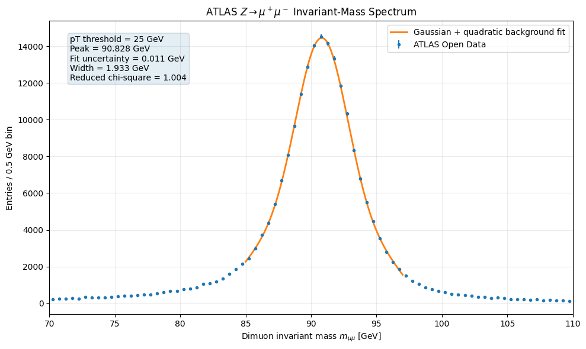
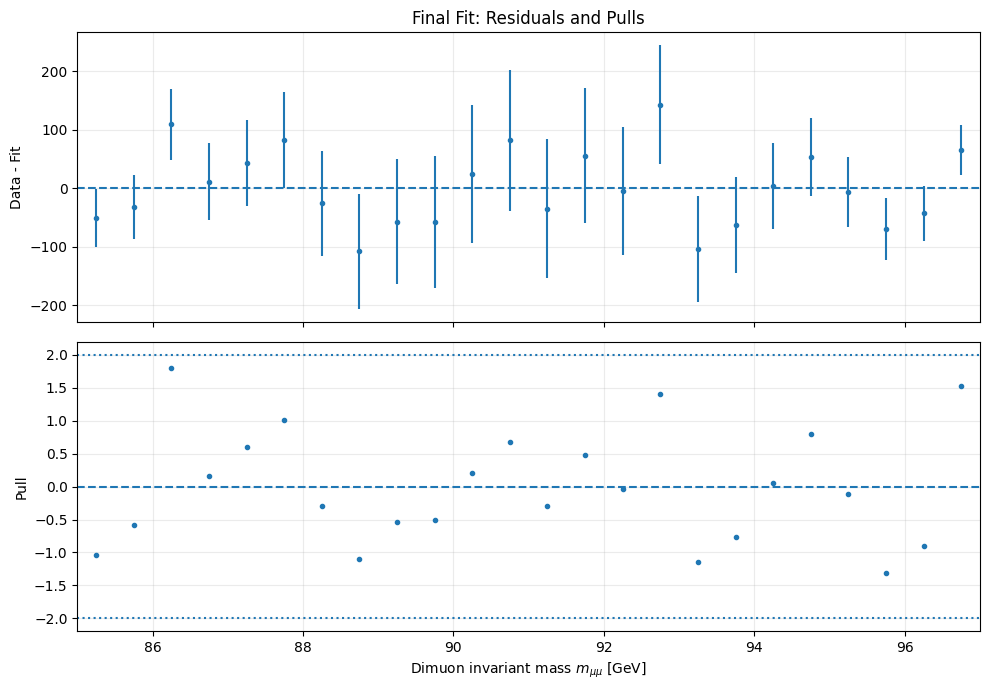

 <div align="center">

# ATLAS Z Boson Reconstruction

### Reproducible Dimuon Resonance Analysis with ATLAS Open Data


**A hands-on particle-physics data analysis project**

Selecting muons, reconstructing the dimuon invariant mass, fitting the Z-boson resonance, and validating the fit using ATLAS Open Data.

</div>

---

## 🔭 Project Overview

This project reconstructs the dimuon invariant-mass spectrum using the educational ATLAS 2-lepton Open Data sample.

The analysis studies the decay channel:

\[
Z \rightarrow \mu^+ \mu^-
\]

The workflow includes ROOT data inspection, event and muon selection, opposite-charge pair construction, four-momentum reconstruction, resonance fitting, fit diagnostics, and selection robustness checks.

> **Scope:** This is an educational and reproducible analysis of an ATLAS Open Data sample. It is not a precision measurement or an official ATLAS scientific result.

## 📊 Final Dimuon Invariant-Mass Spectrum

<p align="center">
  
</p>

## 🧪 Fit Diagnostics

<p align="center">
  
</p>

## ✨ Key Results

| Quantity | Nominal Result |
|---|---:|
| Muon transverse-momentum threshold | 25 GeV |
| Opposite-charge dimuon pair entries | 226,483 |
| Fitted resonance peak | **90.828 GeV** |
| Fit covariance uncertainty | 0.011 GeV |
| Gaussian width | 1.933 GeV |
| Reduced chi-square | 1.004 |

The reported fit uncertainty is the covariance uncertainty obtained from the fit. It does **not** represent a complete statistical and systematic uncertainty evaluation.

## 🧭 Analysis Workflow

1. **Inspect the ROOT dataset** — identify the `mini` tree and relevant muon branches.
2. **Select muons** — apply trigger, identification, transverse-momentum, and pseudorapidity requirements.
3. **Construct dimuon candidates** — combine selected muons and retain opposite-charge pairs.
4. **Reconstruct invariant mass** — calculate the mass from the combined four-momentum.
5. **Fit the resonance** — fit a Gaussian signal plus a quadratic background in the 85–97 GeV region.
6. **Validate the fit** — inspect residuals and pulls, compare fit configurations, and vary the muon \(p_T\) threshold.

## 📐 Reconstruction and Fit Model

For two muons, the invariant mass is calculated from their combined four-momentum:

\[
m_{\mu\mu}^2 =
(E_1+E_2)^2 -
\left|\vec{p}_1+\vec{p}_2\right|^2
\]

The resonance is modelled using a Gaussian signal and a quadratic background:

\[
f(m)=
A\exp\left[-\frac{(m-\mu)^2}{2\sigma^2}\right]
+a(m-91)^2+b(m-91)+c
\]

where:

- \(A\) is the Gaussian amplitude.
- \(\mu\) is the fitted resonance peak.
- \(\sigma\) is the Gaussian width.
- \(a\), \(b\), and \(c\) describe the quadratic background.

The final displayed histogram uses **80 bins over 70–110 GeV**. The fit is performed in the **85–97 GeV** region using the same binning as the displayed spectrum.

## 🛠️ Tools and Libraries

- Python
- Uproot
- Awkward Array
- NumPy
- Pandas
- Matplotlib
- SciPy
- Jupyter Notebook / Google Colab

## 📁 Repository Structure

```text
Atlas-Z-Boson-Reconstruction/
├── README.md
├── notebooks/
│   └── ATLAS_Z_Boson_Reconstruction.ipynb
└── figures/
    ├── atlas_z_dimuon_mass_spectrum.png
    └── atlas_z_fit_residuals_pulls.png
```

## ▶️ Reproduce the Analysis

1. Download the ROOT dataset from the [official CERN Open Data record](https://opendata.cern.ch/record/15003).
2. Open the [analysis notebook](notebooks/ATLAS_Z_Boson_Reconstruction.ipynb) in GitHub or download it for use in Google Colab or Jupyter.
3. Install the required Python packages if they are not already available.
4. Update the ROOT file path in the notebook to match your environment.
5. Run the notebook cells in order.

The large ROOT data file is not included in this repository. Please retrieve it from the official Open Data record.

## 📚 Dataset and Citation

| Property | Description |
|---|---|
| Experiment | ATLAS |
| Collision energy | 13 TeV |
| Integrated luminosity | 10 fb⁻¹ |
| Open Data record | [15003 — ATLAS 2-lepton educational sample](https://opendata.cern.ch/record/15003) |
| DOI | `10.7483/OPENDATA.ATLAS.GQ1W.I9VI` |
| ROOT tree | `mini` |
| Input file | `data_A.2lep.root` |

Please consult the official dataset record for its documentation, scope, and educational-use conditions.

## 🔎 Validation and Robustness

The muon transverse-momentum threshold was varied from 25 to 30 GeV to examine the stability of the fitted resonance peak.

| \(p_T\) Threshold | Pair Entries | Fitted Peak (GeV) | Reduced \(\chi^2\) |
|---:|---:|---:|---:|
| 25 GeV | 226,483 | 90.829 | 1.127 |
| 27 GeV | 211,512 | 90.842 | 1.110 |
| 30 GeV | 186,627 | 90.870 | 0.992 |

The fitted peak shifts by approximately **41 MeV** across the tested selections, while the number of selected dimuon entries decreases as the threshold becomes stricter.

These robustness-table values use an 85–97 GeV fit with 80 bins. They are reported separately from the final displayed-spectrum fit.

## ⚠️ Limitations and Future Work

- The dataset is an educational ATLAS Open Data sample.
- This analysis is not intended as a precision Z-boson mass measurement.
- The fit covariance uncertainty is not a total uncertainty; systematic effects have not been fully evaluated.
- A matched Monte Carlo comparison was not completed because the large educational MC file could not be reliably accessed during this workflow.
- Future extensions could include data–simulation comparison, detector calibration studies, and systematic uncertainty evaluation.

## 👩‍💻 Author

**Kavya Nair**  
MCA Student · MANIT Bhopal

Created as a learning and portfolio project in particle-physics data analysis.

<div align="center">

*Learning to extract physics from data, one event at a time.*

</div>
